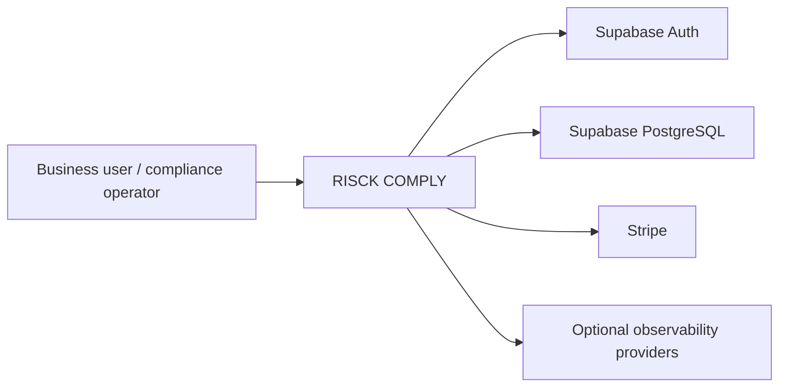
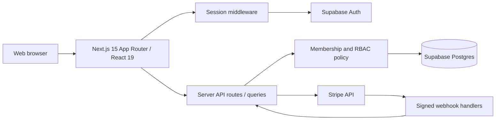

# RISCK COMPLY — Engineering Architecture and Integration Review V1

Baseline: `857ddfb21d0135df3a026ad480da5945119b175c`. Prepared 2026-10-14. **Source-inspection evidence only. No runtime PASS.**

## C4 Level 1 — Context (provisional)

## C4 Level 2 — Containers (source-grounded)

These diagrams are simplified. Do not infer externally verified isolation from these diagrams.

## Direct source observations

- `src/server/queries/current-organization.ts`: `getUserOrganizationMemberships` queries `organization_members` using `user_id` and `status='active'`; normalization rejects any present non-active status. A compatibility path that omits status is reached only after a DB capability RPC returns that the status column is absent; probe error fails closed. **Static reading verified; tests not run.**
- `src/app/api/stripe/webhook/route.ts`: signed request, 1 MB body limit, 300 second signature tolerance, event mode validation, enterprise handling, price authority validation, invoice-subscription pre-sync and common recovery handler.
- `src/app/api/billing/webhook/route.ts`: signed request, 1 MB body limit, 300 second tolerance, event mode validation, enterprise handling, price authority validation and common recovery handler. Unlike the other path, direct invoice-subscription pre-sync is not called. This is a **behavioral divergence requiring tests**, not a proven vulnerability.
- `package.json`: Next.js `15.5.27`, React `^19`, TypeScript `^6`, Stripe `^17.5.0`, Supabase SSR `^0.12.4`, Supabase JS `^2.88.0`, Zod `^4.4.3`, Vitest `4.1.11`, Playwright `^1.56.1`. Versions with ranges are **constraints**, not installed resolved versions.

## Integration boundary matrix

| Boundary | Identity/authority | Source references | Required validation |
|---|---|---|---|
| Browser → Next.js session | Supabase signed user session | `src/middleware.ts`, `src/lib/supabase/server.ts` | Cookies/session expiry and forged claims |
| API → tenant data | Current user and active membership | `src/server/queries/current-organization.ts` | Revoked membership / dual-tenant fixture |
| API → billing | Backend billing authority | `src/server/billing/stripe*` | Test-mode entitlement lifecycle |
| Stripe → webhook | Signed provider event | Both webhook route files | Cross-route parity, event ordering, dedupe, invalid signature |
| Server → data admin client | Elevated DB service authorization | `src/lib/supabase/admin.ts` | All callers require independent tenant permission check |

## Technical debt / uncertainty triage

- **REVIEW-MEDIUM**: distinct Stripe handlers have divergent invoice pre-sync behavior; document intentional routing and test event-order equivalence.
- **REVIEW-MEDIUM**: verify legacy status-less membership fallback never permits suspended membership in any currently deployed schema.
- **REVIEW-MEDIUM**: review elevated Supabase admin-client call sites for tenant and RBAC enforcement.
- **EVIDENCE-GAP**: no lockfile license/resolved-version inventory yet; cannot give definitive license clearance.
- **EVIDENCE-GAP**: no complete exhaustive route inventory, running test suite results or production SHA match.

No confirmed critical/high vulnerability, and no claim of zero existing vulnerabilities.

## Local safe verification plan

1. Prepare ephemeral isolated checkout at recorded SHA. No real .env or production provider credentials.
2. Review fixtures and test setup before `npm run test`.
3. Run `npm ci --ignore-scripts` only in disposable environment after reviewing installation implications.
4. Run static lint/typecheck, isolated offline tests and build only after checking configuration and hooks.
5. Capture command, exit code, duration, tool versions, SHA and redacted failure details.
6. Add focused tests for webhook route parity and membership schema-fallback fail-closed behavior.
7. Do not execute the repository's `security:rls` command by default: it explicitly includes LIVE validation with `--update-register`.

## Buyer qualification limitations

The observations here are technical source facts. Engineering replacement cost, acquisition price, uptime, regulatory compliance, certification, production function, and penetration-test results have **not** been measured by this document. A buyer should confirm ownership, licenses, runtime, data-plane isolation and product behavior separately.

**Verification:** Static source review of named files. **Tests executed:** 0. **Production operations:** 0. **Status:** Working draft, not buyer-accepted.
