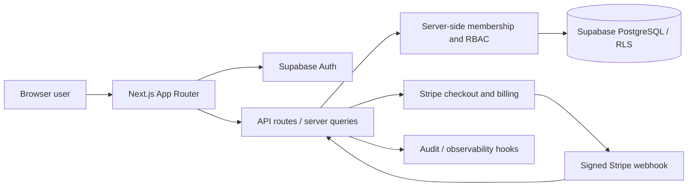

# RISCK COMPLY — Technical Due Diligence Evidence Register V1

**Classification:** Internal buyer-preparation draft; not a certification or independently verified audit.
**Baseline:** `main` @ `857ddfb21d0135df3a026ad480da5945119b175c` (retrieved 2026-10-14).
**Change control:** Documentation only on `codex/dataguard-technical-diligence`. No production writes, deployment, external communication or main merge.

## 1. Evidence ledger

| ID | Technical area | Observed source | Source inspection status | Runtime status | Next validation |
|---|---|---|---|---|---|
| F-01 | Supabase session and OAuth | `src/lib/supabase/server.ts`, `src/middleware.ts`, `src/app/auth/callback/route.ts` | Paths found by GitHub code search; implementations not exhaustively reviewed | NOT TESTED | Local auth session and callback tests |
| F-02 | Organization membership/onboarding | `src/server/queries/current-organization.ts` | Partial source reviewed: status-aware membership handling and onboarding normalization | NOT TESTED | Membership-state and onboarding route tests |
| F-03 | AI system management | `src/app/api/ai-systems/route.ts` | Partial source reviewed: Zod schemas, API guards, origin checks, RBAC, rate limiting and audit helper imports | NOT TESTED | GET/POST/PATCH auth, validation, tenant tests |
| F-04 | AI assessments and RLS | `supabase/migrations/20260703100000_ai_assessments_tenant_rls_hardening.sql` | File discovered; SQL not fully reviewed | NOT TESTED | Isolated two-tenant RLS tests |
| F-05 | Stripe webhook | `src/app/api/billing/webhook/route.ts` | Partial source reviewed: body limit, signature check, rate limit, event mode verification imports | NOT TESTED | Stripe CLI/test-mode signature, retries, idempotency |
| F-06 | Secondary Stripe webhook route | `src/app/api/stripe/webhook/route.ts` | File discovered; functional relationship unclear | NOT TESTED | Establish canonical endpoint and duplicate processing policy |
| F-07 | Export APIs | `src/app/api/gdpr/export/route.ts`, `src/app/api/vendor-assurance/export/route.ts` | Files discovered | NOT TESTED | Access-control and downloadable content tests |

**Important:** The existence of code, migrations, tests or scripts is not proof of their successful runtime execution or deployment.

## 2. Preliminary architecture (subject to full source verification)

### Trust-boundary questions for review
1. Identify every server-side admin/service-role client invocation, caller permissions and tenant guard.
2. Confirm current membership status, not historical membership alone, drives authorization.
3. Confirm Stripe webhook event idempotency and authoritative plan entitlements.
4. Confirm server actions cannot accept untrusted organization identifiers without membership validation.
5. Compare intended release SHA to production SHA independently before any runtime PASS assertion.

## 3. Preliminary engineering findings (not confirmed defects)

| Finding | Priority | Evidence | Required decision |
|---|---|---|---|
| Two Stripe webhook route paths may need explicit canonicalization | Review / medium pending verification | `src/app/api/billing/webhook/route.ts` and `src/app/api/stripe/webhook/route.ts` | Map live/test event destinations and code-level behavior without production changes |
| Current organization resolver supports schema fallback cases | Review / medium pending verification | `src/server/queries/current-organization.ts` | Verify fallback does not weaken active-membership enforcement |
| Broad readiness and security script surface creates execution ambiguity | Review / low | `package.json` defines many scripts including live RLS checks | Classify every script before execution; prohibit provider-write scripts |

No severity-ranked vulnerability has been confirmed by this limited review.

## 4. Test execution register

| Command | Executed? | Exit code | Reason |
|---|---|---|---|
| `npm run lint` | No | N/A | No isolated repository checkout/dependency environment provisioned in this review |
| `npm run typecheck` | No | N/A | Same |
| `npm run test` | No | N/A | Must inspect test scripts and provider side effects first |
| `npm run build` | No | N/A | Requires isolated checkout and verified no external side effects |

No production runtime checks were performed. Source inspection is **not** runtime validation.

## 5. Buyer document deliverable register

| ID | Required deliverable | Status |
|---|---|---|
| D01 | Technical Architecture Overview | Preliminary diagram only |
| D02 | Source-Code Asset Inventory | Partial |
| D03 | Functional Capability Matrix | Partial evidence ledger above |
| D04 | Route/API/Server Action Inventory | Partial |
| D05 | Database Dependency Map | Pending |
| D06 | Third-Party Dependency and License Inventory | Pending |
| D07 | Integration Boundary Matrix | Preliminary |
| D08 | Technical Debt Register | Preliminary triage only |
| D09 | Test Coverage and Validation Report | Execution register only |
| D10 | Build-versus-Buy Engineering Analysis | Pending; never represent estimates as measured costs |
| D11 | Technical Handover Plan | Pending |
| D12 | Known Limitations and Unverified Behaviors | Preliminary |

## 6. Completion logic and blockers

Progress is based on **verified completion**, not the existence of headers or checklists. A document is complete only when its claims have traceable evidence and required checks are executed or explicitly bounded as externally blocked.

**Current verified buyer deliverables: 0/12 fully completed = 0%.** This is a strict acquisition-grade completion score, not an assertion that no work has begun. Seven feature areas are catalogued preliminarily; **0 runtime verified / 7 runtime untested**. Full feature denominator remains unknown until exhaustive route discovery.

**External/operational blockers:** isolated full checkout with dependencies, safe test-mode credentials and tenant fixtures, production-to-main SHA evidence, full dependency/license analysis, independent buyer validation if required.

## 7. Guardrails

- Keep DataGuard demo, accounts and workspaces unchanged.
- Never execute live mutation/security scripts or production write paths.
- Do not merge this draft without evidence review.
- Do not send this internal working draft to buyers as a finished due diligence report.
